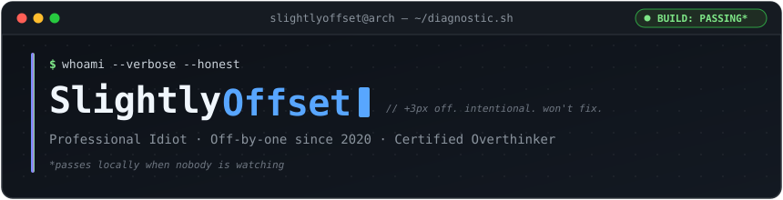

<div align="center">
  <picture>
    <source media="(prefers-color-scheme: dark)" srcset="./assets/banner-dark.svg" />
    <source media="(prefers-color-scheme: light)" srcset="./assets/banner-light.svg" />
    
  </picture>

  <br />

  
  
  
  
</div>

<br />

> **Today's Official Engineering Excuse:**
> <!-- EXCUSE_OF_THE_DAY:START -->
> *"I didn't break production; I discovered a previously unknown edge case."*
> <!-- EXCUSE_OF_THE_DAY:END -->

---

### `cat ~/personnel_file.yml`

```yaml
# CONFIDENTIAL — DO NOT DISTRIBUTE TO HR
handle:      SlightlyOffset
title:       "Professional Idiot"
role:        "IT Student (6 languages at my disposal, none of which are human)"
environment: "Arch Linux + Hyprland (nothing really worked)"

core_competencies:
  - "Turning 5-minute scripts into 3-hour architecture rewrites"
  - "Off-by-one errors in loops, layouts, and life choices"
  - "Enterprise-grade Ctrl+C / Ctrl+V engineering"
  - "Turning functioning code into a non-functioning mess"

known_issues:
  - "[WARN]  Sleep schedule deprecated; no migration path planned"
  - "[ERR]   Brain cells return 404 during exam week"
  - "[INFO]  If a commit message says 'minor fix', assume the worst"
  - "[EXTRA] Functioning alcoholic"
```

---

### Toolkit *(Things I Confidently Google)*

<div align="center">
  
  
</div>

---

### Diagnostics & Easter Eggs

<details open>
  <summary><strong>📊 GitHub Stats (Evidence of Questionable Productivity)</strong></summary>
  <br />
  <div align="center">
    <!-- Fixed the legendary hide_boarder -> hide_border typo. Gone but not forgotten. -->
    <picture>
      <source media="(prefers-color-scheme: dark)" srcset="https://github-readme-stats-alpha-plum-82.vercel.app/api?username=SlightlyOffset&show_icons=true&hide_border=true&theme=github_dark" />
      <source media="(prefers-color-scheme: light)" srcset="https://github-readme-stats-alpha-plum-82.vercel.app/api?username=SlightlyOffset&show_icons=true&hide_border=true&theme=default" />
      
    </picture>
    <picture>
      <source media="(prefers-color-scheme: dark)" srcset="https://github-readme-stats-alpha-plum-82.vercel.app/api/top-langs/?username=SlightlyOffset&layout=compact&hide_border=true&theme=github_dark" />
      <source media="(prefers-color-scheme: light)" srcset="https://github-readme-stats-alpha-plum-82.vercel.app/api/top-langs/?username=SlightlyOffset&layout=compact&hide_border=true&theme=default" />
      
    </picture>
  </div>
</details>

<details>
  <summary><strong>⚠️ Click for Extremely Professional Credentials</strong></summary>
  <br />

  - **Certifications:** Survived `git rebase` without deleting the repo *(mostly)*.
  - **References:** Available upon request *(please do not request)*.
  - **Fun Fact:** You actually opened this dropdown. Respect. Here is a gold star: ⭐

</details>
